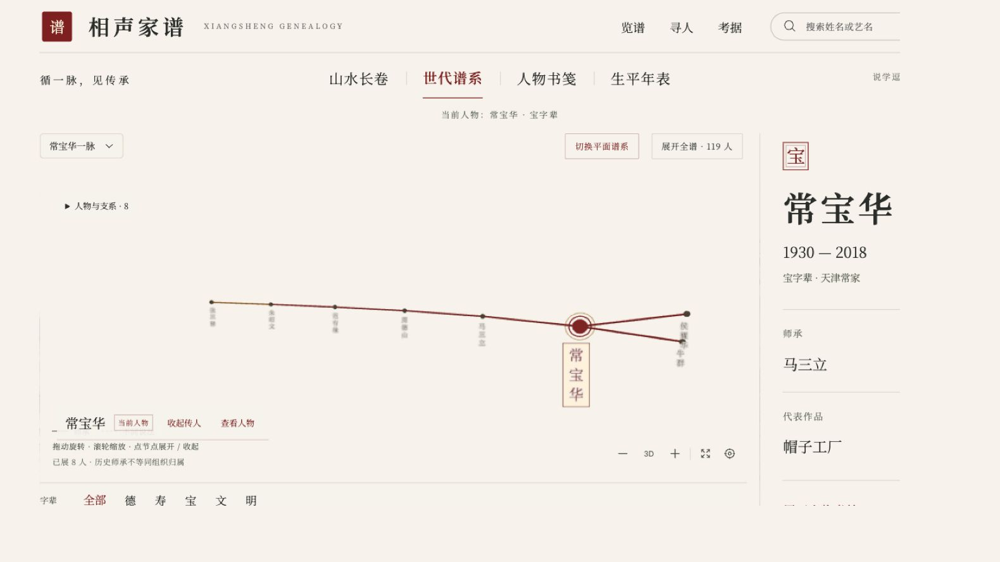

<p align="center"><a href="README.md">简体中文</a> · <a href="README.en.md">English</a> · <a href="README.zh-Hant.md">繁體中文</a> · <a href="README.ja.md">日本語</a> · <a href="README.ko.md">한국어</a></p>

# 相声家譜 · Xiangsheng Genealogy

**一人の演者から、出典のある師弟関係をたどる。中国の話芸「相声」の系譜を読むための地図。**

水墨の絵巻と3Dの星雲で、人物、師弟関係、世代名、関連史料を探索するインタラクティブなアトラスです。異説のない決定版名簿ではなく、相声の音声も配信しません。


## 二つの読み方

- **山水絵巻**：横に移動しながら、山、水面、舟、人物名札を読みます。人物を選ぶと師弟のつながりが朱色で強調されます。背景と前景を別々に動かす視差表現で、密集した関係を整理します。
- **世代系譜**：立体的な星雲で世代を見渡します。クリックで人物と上下流の関係を選択し、ドラッグで回転、スクロールで拡大縮小します。ホバーで別の枝を比較できます。動きを減らす設定にも対応します。



## 起動して読む

ローカルで起動し、端末に表示されるURLを開きます。リポジトリのCIはNode.js 22を使用します。

```bash
git clone https://github.com/jammyfu/xiangsheng-genealogy.git
cd xiangsheng-genealogy
npm ci
npm run dev
```

1. ホームまたは人物への直接リンクから開きます。例：`/p/hou-baolin?view=tree`。
2. 名前の検索と **德・寿・宝・文・明** の世代フィルターを使います。「德寿喜哈」は使いません。
3. 人物を選び、略歴、代表作、師承の説明、出典を確認します。他の節点にポインターを置くと枝を比較できます。
4. 絵巻、世代系譜、タイムライン、書籍風の表示を切り替えます。フィルターは表示範囲を変えるだけで、元データを削除しません。

## 機能と注意点

React、Vite、TypeScript、React Three Fiber、Drei、Three.js、`3d-force-graph`による可視化です。宣紙、水墨、朱色の意匠にNoto Serif SCと馬善政フォントを組み合わせています。

人物のパスは`/p/:id`。別名、世代、作品、出典を表示し、師弟関係、団体、生涯の出来事は別に記録します。WebGLが使えない場合の平面表示経路もありますが、すべての携帯端末で検証済みという意味でも、自動的に平面表示になるという意味でもありません。READMEの5言語対応は、アプリのUIが5言語化済みという意味ではありません。

## データと史料

| 内容 | 管理場所 | 役割 |
| --- | --- | --- |
| 人物 | `data/people/*.json` | 名前、別名、略歴、世代、出典 |
| 師承 | `data/edges.json` | 師から弟子への関係と異説フラグ |
| 出典 | `data/sources.json` | 報道、所蔵資料、機関ページ、利用条件 |
| 出来事 | `data/events.json` | 生涯と団体の履歴を独立して記録 |
| スキーマ | `data/schemas/` | データの検証規則 |

正式な師弟、口頭の約束／受講者、家伝、異説、破門や脱退などを区別します。十分な確認ができない関係は`"disputed": true`と出典・説明を残し、推測を確定事項にしません。[師承監査](docs/lineage-audit-2026-09-12.md)と[収録範囲](docs/data-coverage.md)も参照してください。

## ビルド、テスト、貢献

```bash
npm test
npm run lint
npm run build
npm run preview
```

編集するのは`data/`の現行データです。古いseedで上書きしないでください。新しい主張には出典を付け、異説があれば残します。人物、関係、出来事を変更したらテストとビルドを実行します。人による確認用コピーは`node scripts/emit-seed.mjs --out /tmp/xiangsheng-seed-review`で出力できます。出力先は新しい空ディレクトリに限られ、既存データの上書きは拒否されます。

[貢献ガイド](CONTRIBUTING.md)、[開発計画](docs/next-development-roadmap.md)、[絵巻設計](docs/spatial-scroll-qa.md)、[連続絵巻の解説](docs/continuous-scroll.md)があります。詳細な調査・保守文書は原文のままです。翻訳は史料そのものの代わりにはなりません。

## 利用条件

コードは[MIT](LICENSE)に従い利用・改変・再配布でき、著作権表示とライセンスを残します。人物の事実、編集された文章、第三者の素材を同一の権利として扱わないでください。[NOTICE](NOTICE)と[帰属表示](ATTRIBUTION.md)を確認します。Wikipedia由来の内容は[CC BY-SA 4.0](https://creativecommons.org/licenses/by-sa/4.0/)に従い、帰属表示と同じ条件での共有が必要です。人物画像には仮の印、公有素材、外部リンクがあり、個別の出典を確認してください。音声は収録していません。

[English](README.en.md) · [機械可読の概要](llms.txt)
