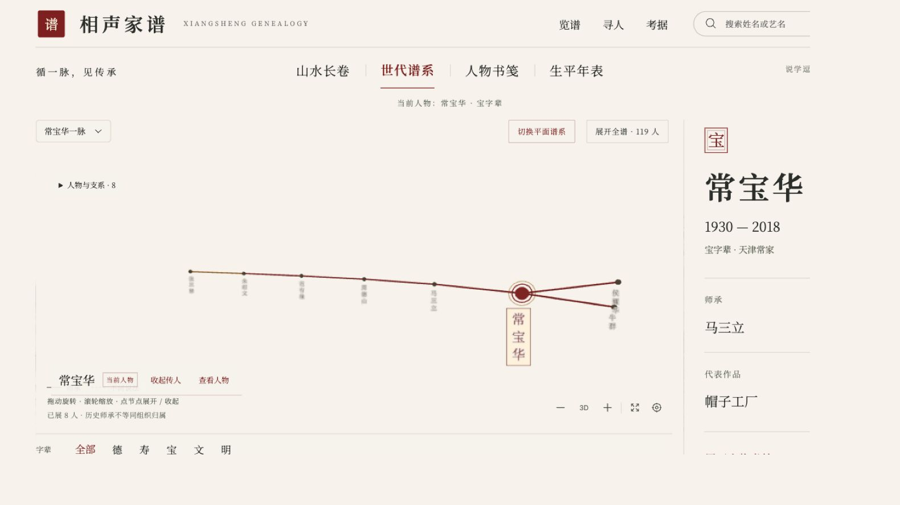

<p align="center"><a href="README.md">简体中文</a> · <a href="README.en.md">English</a> · <a href="README.zh-Hant.md">繁體中文</a> · <a href="README.ja.md">日本語</a> · <a href="README.ko.md">한국어</a></p>

# 相声家谱 · Xiangsheng Genealogy

**한 공연자에서 시작해 출처가 있는 사제 관계를 따라가는 중국 전통 만담 ‘샹성’의 계보 지도입니다.**

수묵 두루마리와 3D 성운을 통해 인물, 사제 관계, 세대명과 관련 사료를 탐색합니다. 이견이 없는 확정 명단이 아니며, 공연 음원을 제공하지 않습니다.


## 두 가지 탐색 방식

- **산수 두루마리**: 가로로 이동하며 산, 물, 배, 인물 이름을 읽습니다. 인물을 선택하면 사제 관계가 붉은 선으로 강조됩니다. 전경과 배경이 서로 다른 속도로 움직여 복잡한 관계를 구분합니다.
- **세대 계보**: 입체적인 성운에서 세대를 살펴봅니다. 클릭해 인물과 연결 관계를 고정하고, 드래그로 회전하며 스크롤로 확대·축소합니다. 마우스를 올리면 다른 갈래를 비교할 수 있습니다. 움직임 줄이기 설정도 지원합니다.



## 실행하고 살펴보기

로컬에서 실행한 뒤 터미널에 표시된 주소를 엽니다. 저장소 CI는 Node.js 22를 사용합니다.

```bash
git clone https://github.com/jammyfu/xiangsheng-genealogy.git
cd xiangsheng-genealogy
npm ci
npm run dev
```

1. 홈이나 인물 직접 링크로 진입합니다. 예: `/p/hou-baolin?view=tree`.
2. 이름 검색과 **德·寿·宝·文·明** 세대 필터를 사용합니다. ‘德寿喜哈’는 쓰지 않습니다.
3. 인물을 선택해 약력, 대표작, 사제 관계 설명과 출처를 확인합니다. 다른 노드에 마우스를 올려 갈래를 비교합니다.
4. 두루마리, 세대 계보, 타임라인, 책 형태 보기를 전환합니다. 필터는 표시 범위만 바꾸며 원본 데이터를 삭제하지 않습니다.

## 기능과 한계

React, Vite, TypeScript, React Three Fiber, Drei, Three.js, `3d-force-graph`를 사용합니다. 선지·수묵·주홍색을 중심으로 Noto Serif SC와 馬善政 글꼴을 사용합니다.

인물 경로는 `/p/:id`입니다. 별명, 세대, 작품, 출처를 제공하며 사제 관계, 단체, 생애 사건은 별도로 표현합니다. WebGL을 사용할 수 없을 때 평면으로 읽는 경로도 있지만 모든 휴대전화에서 검증되었거나 자동으로 평면 모드가 된다는 뜻은 아닙니다. README의 5개 언어 지원은 앱 UI의 5개 언어 지원을 의미하지 않습니다.

## 데이터와 사료

| 내용 | 관리 위치 | 역할 |
| --- | --- | --- |
| 인물 | `data/people/*.json` | 이름, 별명, 약력, 세대, 출처 |
| 사제 관계 | `data/edges.json` | 스승에서 제자로 이어지는 관계와 이견 표시 |
| 출처 | `data/sources.json` | 기사, 소장 자료, 기관 페이지, 이용 조건 |
| 사건 | `data/events.json` | 생애와 단체의 이력을 독립적으로 기록 |
| 스키마 | `data/schemas/` | 데이터 검증 규칙 |

정식 사제, 구두 약속/수강생, 가전, 논란, 파문·탈퇴 등을 구분합니다. 충분히 검증되지 않은 관계는 `"disputed": true`, 출처와 설명을 남깁니다. 추정을 확정 사실처럼 표현하지 않습니다. [사제 관계 검토](docs/lineage-audit-2026-09-12.md)와 [수록 범위](docs/data-coverage.md)를 참고하세요.

## 빌드, 테스트, 기여

```bash
npm test
npm run lint
npm run build
npm run preview
```

`data/`의 현재 데이터를 편집하고 과거 seed로 덮어쓰지 않습니다. 새로운 주장에는 출처를 붙이고 이견도 기록합니다. 인물, 관계, 사건을 변경한 뒤 테스트와 빌드를 실행합니다. 사람이 확인할 사본은 `node scripts/emit-seed.mjs --out /tmp/xiangsheng-seed-review`로 내보낼 수 있습니다. 새 빈 디렉터리만 허용하며 기존 데이터 덮어쓰기는 거부합니다.

[기여 안내](CONTRIBUTING.md), [개발 계획](docs/next-development-roadmap.md), [두루마리 설계](docs/spatial-scroll-qa.md), [연속 두루마리 안내](docs/continuous-scroll.md)를 제공합니다. 상세 연구·유지보수 문서는 원문으로 남아 있습니다. 번역은 원본 사료를 대체하지 않습니다.

## 이용 조건

코드는 [MIT](LICENSE)에 따라 사용·수정·재배포할 수 있으며 저작권 및 라이선스 고지를 유지해야 합니다. 인물에 대한 사실, 편집된 글, 제3자 소재의 권리를 구분하세요. [NOTICE](NOTICE)와 [출처 표시](ATTRIBUTION.md)를 확인합니다. Wikipedia 파생 내용은 [CC BY-SA 4.0](https://creativecommons.org/licenses/by-sa/4.0/)에 따라 출처를 표시하고 동일 조건으로 공유해야 합니다. 인물 이미지는 임시 인장, 퍼블릭 도메인 소재 또는 외부 링크일 수 있으므로 개별 출처를 확인합니다. 이 저장소는 음원을 제공하지 않습니다.

[English](README.en.md) · [기계가 읽는 개요](llms.txt)
