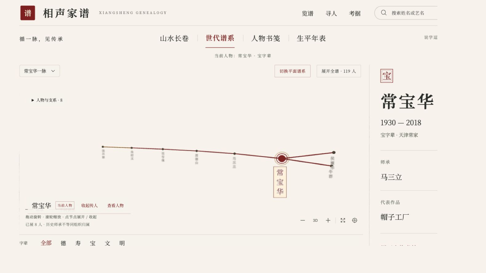

<p align="center"><a href="README.md">简体中文</a> · <a href="README.en.md">English</a> · <a href="README.zh-Hant.md">繁體中文</a> · <a href="README.ja.md">日本語</a> · <a href="README.ko.md">한국어</a></p>

# 相聲家譜 · Xiangsheng Genealogy

**從一位演員出發，沿著有來源的師承關係，讀懂相聲的傳承。**

以水墨長卷與三維星雲探索人物、師徒關係、字輩及相關史料。這是可檢索、可比對來源的互動圖譜，不是無爭議的權威名冊，也不提供相聲錄音。


## 選擇閱讀方式

- **山水長卷**：橫向瀏覽分層山水、舟船與人物名牌；選取人物後，以朱砂線條突出師承脈絡。視差、前景與背景分開移動，讓密集關係更容易閱讀。
- **世代譜系**：以三維星雲探索世代；按一下人物鎖定上下游關係，拖曳旋轉、捲動縮放，游標停留時比較旁支。支援降低動態效果偏好。



## 如何開始

先在本機啟動，再開啟終端機顯示的網址。儲存庫 CI 使用 Node.js 22。

```bash
git clone https://github.com/jammyfu/xiangsheng-genealogy.git
cd xiangsheng-genealogy
npm ci
npm run dev
```

1. 從首頁或人物深層連結進入，例如 `/p/hou-baolin?view=tree`。
2. 用姓名搜尋或 **德、壽、寶、文、明** 字輩篩選；此處不使用「德壽喜哈」。
3. 選取人物，閱讀小傳、代表作品、師承說明及資料來源；把游標移到其他節點可比較分支。
4. 在山水長卷、世代譜系、時間線與書頁之間切換。篩選只改變目前閱讀範圍，不會刪除原始資料。

## 功能與邊界

React、Vite、TypeScript、React Three Fiber、Drei、Three.js 與 `3d-force-graph` 提供互動視覺化。介面採宣紙、水墨和朱砂風格，使用 Noto Serif SC 與馬善政字型。

人物網址為 `/p/:id`。人物資訊含別名、字輩、作品和來源；關係、組織與生平事件分開表達。WebGL 無法使用時可使用對應平面閱讀方式；這不等於所有手機都經過驗證，也不表示會自動切成平面模式。README 有五種語言，不代表應用程式介面已支援五語。

## 資料與史料

| 內容 | 維護位置 | 用途 |
| --- | --- | --- |
| 人物 | `data/people/*.json` | 姓名、別名、小傳、字輩與來源 |
| 師承 | `data/edges.json` | 師父到徒弟的關係及爭議標記 |
| 來源 | `data/sources.json` | 報導、館藏、機構網頁與授權資訊 |
| 事件 | `data/events.json` | 生平與組織事件，不用單一狀態抹去歷史 |
| 結構 | `data/schemas/` | 資料驗證規則 |

區分正式師徒、口盟／學員、家傳、爭議、清門或退出等情況。未充分核實的關係保留 `"disputed": true`、來源及說明，不將推測寫成定論。詳見[師承稽核](docs/lineage-audit-2026-09-12.md)與[資料涵蓋說明](docs/data-coverage.md)。

## 建置、測試與貢獻

```bash
npm test
npm run lint
npm run build
npm run preview
```

只維護 `data/` 中的現有目錄，勿用歷史 seed 覆蓋。新增主張應附可查證來源，有分歧就記錄分歧。修改人物、關係或事件後重新測試及建置。匯出人工核對副本可執行 `node scripts/emit-seed.mjs --out /tmp/xiangsheng-seed-review`；匯出器只接受新的空目錄，拒絕覆寫現有資料。

閱讀[貢獻指南](CONTRIBUTING.md)、[開發路線](docs/next-development-roadmap.md)、[長卷設計](docs/spatial-scroll-qa.md)及[連續長卷說明](docs/continuous-scroll.md)。深入研究與維護文件保留原文；翻譯不取代史料原始來源。

## 可以怎麼使用？

程式碼可依 [MIT](LICENSE) 使用、修改及散布，保留授權聲明。人物史實、編纂文字與第三方素材的權利不能混為一談；請參閱 [NOTICE](NOTICE) 與[署名資料](ATTRIBUTION.md)。維基百科衍生內容遵循 [CC BY-SA 4.0](https://creativecommons.org/licenses/by-sa/4.0/)，需署名並依相同條款分享。人物圖像可能為佔位印、公有領域素材或外部連結，依個別來源判斷。儲存庫不提供錄音。

[English](README.en.md) · [機器可讀摘要](llms.txt)
